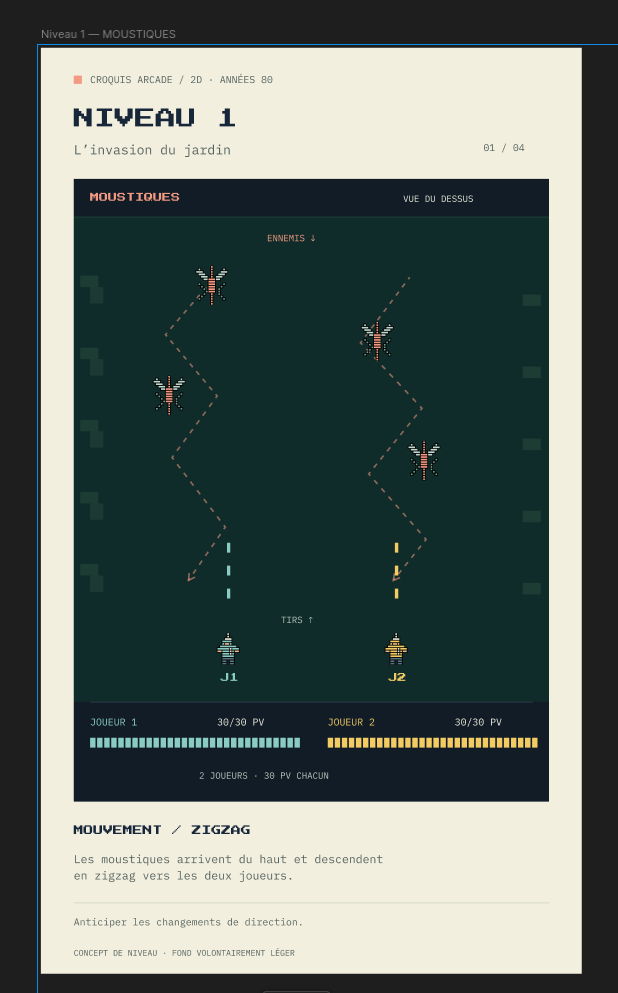

# GDD — Natural Fatal IA

> Shoot'em up 2D coopératif (1 à 2 joueurs), vue verticale / du dessus, style arcade années 80.

## 1. Vue d'ensemble

- **Titre :** Natural Fatal IA
- **Genre :** Shoot'em up 2D à scrolling vertical.
- **Joueurs :** 1 à 2 joueurs en simultané, en bas de l'écran.
- **Structure :** 4 niveaux avec une difficulté croissante.
- **But :** Éliminer les ennemis à l'aide des armes, survivre aux vagues et vaincre le boss final (IA Fatale).
- **Style visuel :** Shoot'em up des années 80, volontairement simple, sans fonctionnalités superflues.

## 2. Règles du jeu

### 2.1 Objectif

Faire disparaître les ennemis (insectes, animaux, IA) en leur infligeant des dégâts avec les armes des joueurs.

### 2.2 Joueurs et points de vie

- Chaque joueur commence avec **30 PV** (maximum : 30).
- Chaque joueur possède une arme de base pour éliminer les ennemis.
- Il n'y a pas d'armes différentes à débloquer.
- La barre de PV de chaque joueur est affichée en bas de l'écran.
- Être touché par un ennemi fait perdre des PV. À 0 PV, le joueur est éliminé.

### 2.3 Ennemis et progression

La difficulté augmente à chaque niveau :

| Niveau | Ennemi | Dégâts au contact | Déplacement |
| --- | --- | --- | --- |
| 1 | Moustiques | 2 | Zigzag en descendant |
| 2 | Guêpes | 6 | Circulaire / en rond |
| 3 | Corbeaux | 10 | Ligne droite vers le bas |
| 4 | IA Fatale (boss final) | À définir | Évolutif selon ses PV (voir 3.4) |

### 2.4 Apparition et combat

- Les ennemis arrivent par le haut de l'écran et descendent vers les joueurs.
- Ils apparaissent petit à petit, à des moments aléatoires.
- Il faut les esquiver et les détruire avant qu'ils ne touchent les joueurs.
- Tuer des ennemis fait gagner de l'XP.

> Point à préciser : utilisation de l'XP, dégâts de l'arme du joueur, PV des ennemis et dégâts du boss.

### 2.5 Bonus

- Des bonus peuvent tomber du haut de l'écran, au même endroit que les ennemis.
- Il faut les attraper sans se faire attaquer.
- Bonus prévu : récupération de points de vie.

> Point à préciser : taux d'apparition, valeur de soin, autres bonus éventuels.

## 3. Design et fonctionnalités des niveaux

Ces designs ne sont pas définitifs. Ils définissent la direction artistique du projet.
Certains ajustements ont déjà été faits pour le confort de réalisation et la lisibilité,
tout en restant fidèles à cette première version.

Principe commun : vue verticale / du dessus. Les ennemis viennent du haut et descendent
vers les joueurs placés en bas de l'écran.

### 3.1 Niveau 1 — L'invasion du jardin

- **Ennemis :** moustiques.
- **Déplacement :** en zigzag, pour représenter le vol aléatoire de l'insecte.
- **Dégâts :** 2.
- **Particularité :** ennemis plus simples à éliminer, niveau d'introduction.

Conseil de jeu : anticiper les changements de direction.

### 3.2 Niveau 2 — La ronde des guêpes

- **Ennemis :** guêpes.
- **Déplacement :** en rond, après leur arrivée par le haut.
- **Dégâts :** 6 au contact.

Conseil de jeu : viser leur passage sur la trajectoire circulaire.

### 3.3 Niveau 3 — La traversée des corbeaux

- **Ennemis :** corbeaux.
- **Déplacement :** en ligne droite, du haut vers les joueurs.
- **Dégâts :** 10 au contact.

Conseil de jeu : se décaler pour éviter les couloirs de descente.

### 3.4 Niveau 4 — L'intelligence maléfique

- **Ennemi :** Robot IA (boss final, combat final).
- **Affichage :** barre de PV dédiée au boss en haut de l'écran.
- **Déplacement :** évolutif selon ses PV :
  - PV élevés : balayage horizontal.
  - PV moyens : zigzag.
  - PV faibles : poursuite des joueurs.

> Point à préciser : PV du boss, patterns d'attaque et dégâts infligés.

## 4. Interface

- Zone de jeu centrale : ennemis en haut, tirs vers le haut, joueurs J1 / J2 en bas.
- Bas de l'écran : PV de chaque joueur (`30/30 PV`), sous forme de barre.
- Niveau 4 : ajout d'une barre de PV pour le boss.
