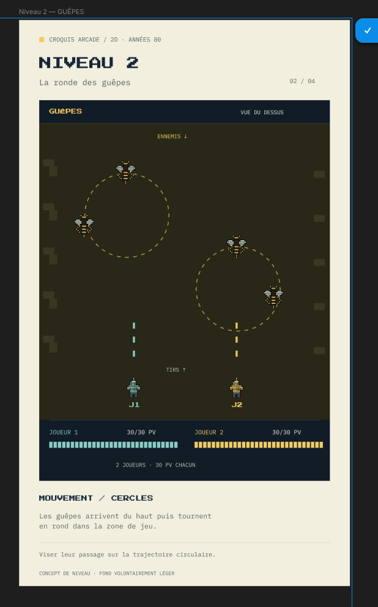
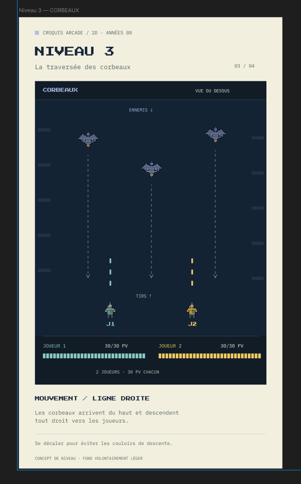
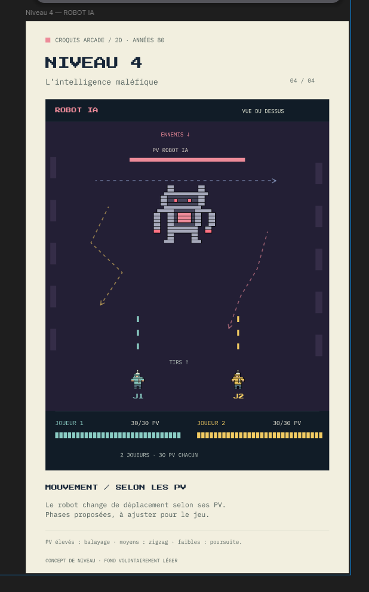

# GDD — Natural Fatal IA

> Shoot'em up 2D coopératif à 2 joueurs, vue verticale / du dessus, style arcade années 80.
> Les valeurs ci-dessous sont celles du code. Ce qui est prévu mais pas encore codé est signalé.

## 1. Vue d'ensemble

- **Titre :** Natural Fatal IA
- **Genre :** Shoot'em up 2D vertical, sur un écran fixe de 960 x 540.
- **Joueurs :** 2 joueurs en simultané sur le même clavier, en bas de l'écran. On peut jouer seul : le second joueur reste alors immobile.
- **Structure :** 4 niveaux avec une difficulté croissante, le dernier contre le boss.
- **But :** Éliminer les vagues d'ennemis, survivre et vaincre le boss final (IA Fatale).
- **Style visuel :** Shoot'em up arcade des années 80-90 : sprites animés, décors procéduraux, typographie monospace, panneaux, cadre CRT et scanlines.
- **Ambiance sonore :** musique de fond bouclée en continu, ajoutée à la direction artistique pour renforcer l'immersion et l'ambiance de borne d'arcade.

## 2. Règles du jeu

### 2.1 Objectif

Faire disparaître les ennemis (insectes, animaux, IA) en leur infligeant des dégâts avec les armes des joueurs.

### 2.2 Joueurs et points de vie

- Chaque joueur commence avec **30 PV** (maximum : 30) et se déplace à 300 px/s, sans pouvoir sortir de l'écran.
- Chaque joueur possède une arme de base : **1 dégât par tir**, un tir toutes les **0,2 s**, balle à 600 px/s vers le haut.
- Il n'y a pas d'armes différentes à débloquer.
- La barre de PV et le score de chaque joueur sont affichés en haut de l'écran (1P à gauche, 2P à droite). La barre clignote en rouge quand le joueur perd des PV.
- Être touché par un ennemi fait perdre des PV. À 0 PV, le joueur est éliminé et l'autre continue seul.
- La partie est perdue quand les deux joueurs sont éliminés.

### 2.3 Ennemis et progression

La difficulté augmente à chaque niveau :

| Niveau | Ennemi                 | PV  | Dégâts au contact | Score | Déplacement                         | Vagues   |
| ------ | ---------------------- | --- | ----------------- | ----- | ----------------------------------- | -------- |
| 1      | Moustiques             | 2   | 2                 | 100   | Zigzag en descendant (100 px/s)     | 3, 6, 10 |
| 2      | Guêpes                 | 3   | 6                 | 200   | Ligne droite vers le bas (100 px/s) | 3, 5, 8  |
| 3      | Corbeaux               | 5   | 10                | 300   | Descente lente (70 px/s) puis piqué (425 px/s) | 3, 5, 8  |
| 4      | IA Fatale (boss final) | 100 | 10                | 1000  | Évolutif selon ses PV (voir 3.4)    | 1        |

### 2.4 Apparition et combat

- Chaque niveau est découpé en vagues. Les ennemis d'une vague arrivent ensemble par le haut, répartis régulièrement sur la largeur de l'écran.
- La vague suivante arrive quand la précédente est éliminée ou sortie par le bas de l'écran. Le niveau se termine quand toutes ses vagues sont passées.
- Un moustique, une guêpe ou un corbeau qui touche un joueur lui inflige ses dégâts puis est détruit. Le boss, lui, n'est pas détruit au contact.
- Tuer un ennemi rapporte son score au joueur qui l'a abattu.
- Une fois le boss vaincu, la partie se termine sur l'écran de fin, avec le score total des deux joueurs.

### 2.5 Potions de soin

- Une potion tombe du haut de l'écran, à un endroit aléatoire, toutes les **6 à 12 secondes**, à 120 px/s.
- Il suffit de la toucher pour la ramasser. Elle rend **10 PV**, sans dépasser le maximum de 30, et ne soigne qu'une seule fois.
- Une fois ramassée, elle joue une courte animation puis disparaît. Une potion qui sort par le bas de l'écran est perdue.

## 3. Design et fonctionnalités des niveaux

Ces designs ne sont pas définitifs. Ils définissent la direction artistique du projet.
Certains ajustements ont déjà été faits pour le confort de réalisation et la lisibilité,
tout en restant fidèles à cette première version.

Principe commun : vue verticale / du dessus. Les ennemis viennent du haut et descendent
vers les joueurs placés en bas de l'écran.

### 3.1 Niveau 1 — L'invasion du jardin

- **Ennemis :** moustiques, en 3 vagues (3, 6 puis 10).
- **Déplacement :** en zigzag en descendant, pour représenter le vol aléatoire de l'insecte.
- **Dégâts :** 2 au contact. **PV :** 2.
- **Particularité :** ennemis plus simples à éliminer, niveau d'introduction.

Conseil de jeu : anticiper les changements de direction.

### 3.2 Niveau 2 — La ronde des guêpes

- **Ennemis :** guêpes, en 3 vagues (3, 5 puis 8).
- **Déplacement :** en ligne droite vers le bas. La trajectoire en rond du croquis n'est pas encore implémentée.
- **Dégâts :** 6 au contact. **PV :** 3.

Conseil de jeu : tirer dès leur arrivée, avant qu'elles n'atteignent le bas de l'écran.

### 3.3 Niveau 3 — La traversée des corbeaux

- **Ennemis :** corbeaux, en 3 vagues (3, 5 puis 8).
- **Déplacement :** descente lente (70 px/s pendant 0,8 s) puis piqué rapide vers le bas (425 px/s), comme un corbeau qui fond sur les joueurs.
- **Dégâts :** 10 au contact. **PV :** 5.

Conseil de jeu : se décaler pour éviter les couloirs de descente.

### 3.4 Niveau 4 — L'intelligence maléfique

- **Ennemi :** Robot IA (boss final, combat final), seul.
- **PV :** 100. **Dégâts :** 10 au contact, pas de tirs.
- **Déplacement :** évolutif selon ses PV :
  - PV au-dessus des 2/3 : balayage horizontal lent (60 px/s).
  - PV sous les 2/3 : balayage horizontal rapide (140 px/s).
  - PV sous le 1/3 : balayage horizontal rapide (220 px/s) avec va-et-vient vertical (130 px/s, entre y = 60 et la moitié de l'écran), pour ne jamais rester immobile sous les tirs.
- **Affichage :** barre de PV dédiée au boss en haut de l'écran (`BossHealthBar`, 300 px centrée, avec `PV/max`).

## 4. Interface

- Direction artistique arcade 80-90 commune à tous les écrans : fond sombre, typographie monospace, panneaux à double bordure, coins en équerre, cadre CRT, scanlines et vignettage (`ArcadeTheme`).
- Écran titre : logo néon, rappel des touches dans deux panneaux `1P` / `2P`, invitation `PRESS ENTER TO START`, `T` pour configurer les touches et `F11` pour le plein écran.
- Écran des touches (`ControlsState`) : deux colonnes encadrées, une par joueur, avec les actions et leurs touches. La ligne sélectionnée est mise en évidence, la touche en cours de modification clignote.
- En partie : décor animé propre à chaque niveau, ennemis en haut, tirs vers le haut, joueurs en bas.
- Haut de l'écran : barres de vie segmentées, PV (`HP 30/30`) et score sur 6 chiffres pour chaque joueur (`1P` à gauche, `2P` à droite), badge de stage au centre (`STAGE 01 // JARDIN`).
- Pause (Échap) : la partie reste visible, assombrie, avec « PAUSE », `ESC // RESUME MISSION` et `T // CONFIGURER LES TOUCHES`.
- Fin de partie : « GAME OVER » en rouge avec effet de grésillement et panneau `FINAL SCORE` quand les deux joueurs sont éliminés ; « MISSION COMPLETE » en vert quand le boss est vaincu, avec le score total et un rang (S, A, B ou C). Entrée pour rejouer, Échap pour revenir au menu.
- Niveau 4 : barre de PV du boss affichée en haut au centre, dans un panneau `WARNING // EVIL AI`, avec ses PV (`hp/max`).
- Le jeu démarre en plein écran et s'adapte au ratio 16:9. `F11` bascule entre plein écran et fenêtré ; Échap reste réservé à la pause.

### 4.1 Démarche artistique et ambiance sonore

La direction artistique arcade a été complétée par l'ajout d'une musique de fond,
pour donner une meilleure ambiance et éviter un jeu totalement silencieux. La piste
`freesound_community-idea-34284.wav` dure **30,4 secondes** et est jouée en boucle
continue : à la fin, elle repart automatiquement du début. Son volume est baissé à
**-8 dB** pour rester en fond sonore et ne pas gêner le jeu.

La musique est lancée au démarrage et accompagne le menu, les parties et les écrans
de fin. Elle ne dépend pas de l'état du jeu : une pause ou un changement d'écran ne
la coupe pas. Si le fichier ou le périphérique audio est absent, le jeu continue
sans erreur, en silence.
