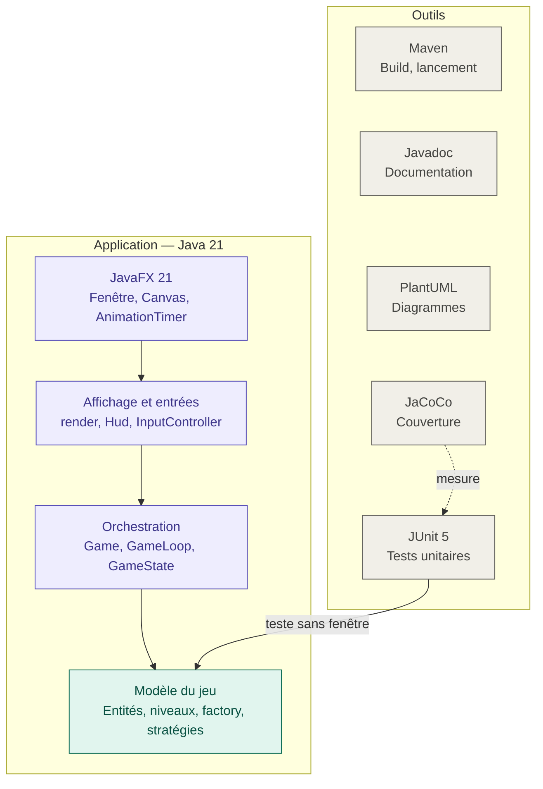

# Stack technique & GUI - Shoot'em up

Ce document présente les technologies utilisées dans le projet et justifie le choix de l'interface graphique.

## Vue d'ensemble

| Rôle                  | Outil               | Version        |
| --------------------- | ------------------- | -------------- |
| Langage               | Java                | 21 (LTS)       |
| Interface graphique   | JavaFX              | 21             |
| Build et lancement    | Maven               | 3.9+           |
| Tests unitaires       | JUnit               | 5              |
| Couverture de tests   | JaCoCo              | 0.8+           |
| Documentation du code | Javadoc             | intégré au JDK |
| Diagrammes            | PlantUML + Graphviz | -              |
| Versionnement         | Git                 | -              |

## Choix de l'interface graphique : JavaFX

Le sujet propose trois options : JavaFX, AWT/Swing ou une solution frontend JavaScript. Nous avons retenu **JavaFX**.

### Comparaison

| Critère        | JavaFX                                | AWT/Swing                                  | Frontend JS                              |
| -------------- | ------------------------------------- | ------------------------------------------ | ---------------------------------------- |
| Boucle de jeu  | `AnimationTimer` intégré              | à coder avec un `Timer` ou un thread       | `requestAnimationFrame` côté navigateur  |
| Dessin         | `Canvas`, accélération matérielle     | `paintComponent`, double buffering à gérer | Canvas HTML                              |
| Menus et HUD   | composants modernes, stylables en CSS | composants datés                           | très flexible                            |
| Mise en place  | faible, bootstrap fourni              | moyenne                                    | élevée : communication Java ↔ JavaScript |
| Logique de jeu | entièrement en Java                   | entièrement en Java                        | partagée entre deux langages             |

### Justification

**Adapté à un jeu d'action.** Le `Canvas` et son `GraphicsContext` permettent de dessiner sprites, projectiles et effets à chaque image, avec une accélération matérielle. L'`AnimationTimer` appelle la boucle de jeu environ 60 fois par seconde, ce qui correspond directement à notre classe `GameLoop`.

**Cohérent avec la conception.** Nos diagrammes et nos design patterns s'appuient déjà sur les classes JavaFX (`GraphicsContext` dans `Renderable`, `KeyCode` dans `GameState`, `Image` dans `AssetManager`).

**Centré sur l'objectif du projet.** Le sujet évalue la maîtrise de la POO en Java. Avec JavaFX, toute la logique reste en Java. Une solution JavaScript aurait ajouté une couche de communication entre deux langages sans apport pédagogique.

**Base fournie.** Le bootstrap du sujet est en JavaFX, ce qui réduit le temps de mise en place au profit du gameplay.

### Pourquoi pas les autres options

AWT/Swing fonctionnerait, mais demande de gérer soi-même le rafraîchissement et le double buffering pour éviter le scintillement, pour un rendu moins fluide. Le frontend JS impose deux projets à faire communiquer (serveur Java et affichage web), ce qui complexifie le jeu sans renforcer la partie orientée objet.

## Architecture : séparer la logique de l'affichage

JavaFX est volontairement cantonné à la couche d'affichage et d'entrées.

| Couche        | Contenu                                                                                                 | Dépend de JavaFX ? |
| ------------- | ------------------------------------------------------------------------------------------------------- | ------------------ |
| Modèle        | `Entity`, `Character`, `Enemy`, `Level`, `Wave`, `EnemyFactory`, `MovementStrategy`, `CollisionManager` | non                |
| Affichage     | méthodes `render`, `Hud`, `AssetManager`                                                                | oui                |
| Entrées       | `InputController`, `handleInput` des `GameState`                                                        | oui                |
| Orchestration | `Game`, `GameLoop` (`AnimationTimer`)                                                                   | oui                |

Conséquence directe : toute la logique du jeu (dégâts, déplacements, vagues, fin de niveau) se teste avec JUnit **sans ouvrir de fenêtre**, ce qui permet une bonne couverture JaCoCo.

## Prérequis

Sur Fedora :

```bash
sudo dnf install java-21-openjdk-devel maven graphviz
```

Sur Ubuntu / Debian :

```bash
sudo apt install openjdk-21-jdk maven graphviz
```

Vérification :

```bash
java -version
mvn -version
```

JavaFX n'a pas besoin d'être installé à part : Maven le télécharge comme dépendance du projet.

## Commandes utiles

| Action                | Commande               | Résultat                                                                                            |
| --------------------- | ---------------------- | --------------------------------------------------------------------------------------------------- |
| Lancer le jeu         | `mvn clean javafx:run` | ouvre la fenêtre du jeu                                                                             |
| Lancer les tests      | `mvn test`             | exécute les tests JUnit                                                                             |
| Rapport de couverture | `mvn verify`           | rapport dans `target/site/jacoco/index.html`                                                        |
| Générer la Javadoc    | `mvn javadoc:javadoc`  | documentation dans `target/reports/apidocs/` (ou `target/site/apidocs/` selon la version du plugin) |

## Liens

- JavaFX : https://openjfx.io
- JUnit 5 : https://junit.org/junit5
- JaCoCo : https://www.jacoco.org/jacoco
- PlantUML : https://plantuml.com

---

## Schéma de l'architecture



Les flèches pleines se lisent « appelle ». En violet, les couches qui dépendent de JavaFX ; en vert, le modèle du jeu, écrit en Java pur. Cette séparation permet à JUnit de tester toute la logique du jeu sans ouvrir de fenêtre, et à JaCoCo de mesurer cette couverture. Maven pilote l'ensemble : compilation, lancement, tests et génération de la Javadoc.
